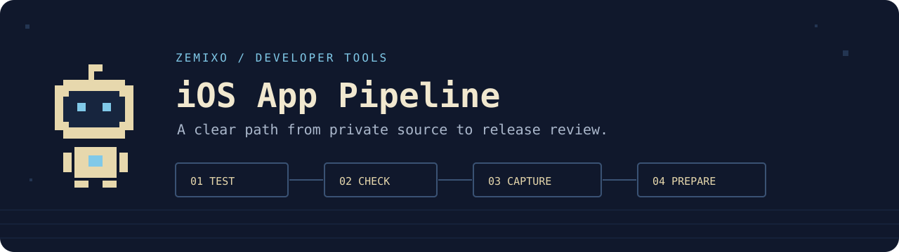

# iOS App Pipeline



**把测试、预审、截图和归档串起来，生成可核对的发布准备结果。**

面向独立开发者的本地 CLI。用 TOML 配置接入自己的私有 Xcode 工程；每一步
都必须产出指定文件，失败就停止。中断后续跑前，会核对源码、配置、声明的环境
和已完成产物。Python 3.11+，无 Python 运行时依赖；Xcode 阶段需要 macOS。

```sh
git clone https://github.com/zemixo/ios-app-pipeline.git
cd ios-app-pipeline
python3 -m venv .venv
. .venv/bin/activate
python -m pip install .
ios-pipeline plan --config pipeline.demo.toml
ios-pipeline run --config pipeline.demo.toml
```

这个演示使用合成 JSON 和 16 × 16 PNG，只验证编排能力。真实 iOS 验收由
`native_fixture.py` 动态生成全新的演示 App，执行 XCTest、UI 截图和未签名归档。
它不读取现有商业 App，不使用 Apple 账号密钥。

把 `pipeline.example.toml` 复制为私有工程的 `pipeline.local.toml`，配置 scheme、
测试设备、截图任务及版本信息。把 `.ios-pipeline/` 和 `pipeline.local.toml` 加入
该工程的 `.gitignore`，再参考 [接入指南](INTEGRATION.md)。

| 阶段 | 通过条件 |
|---|---|
| 测试 | 读取真实 xcresult，达到配置的测试数量，没有失败、跳过或预期失败 |
| 预审 | 可选接入 apple-presubmit-audit，根据退出状态阻断 |
| 截图 | 所有指定图片存在，PNG 结构、校验和、可选尺寸匹配 |
| 归档 | App 与归档内的 Bundle ID、版本、构建号一致且匹配配置 |
| 续跑 | 配置、源码、声明的环境、已完成产物保持一致 |

成功状态是 `READY_FOR_REVIEW`，表示可进入人工核对阶段。测试数量不能代表业务
场景全部覆盖，图片格式正确不能代表视觉质量，归档身份一致不能代表签名或审核通过。

首版包含开发流程模板和发布准备工具；自动生成 App、上传、替换线上素材、提交审核、
改价不属于内置操作。配置中的命令由你提供，可能产生自己的副作用，执行前需要审阅。
运行日志和产物保留在本地，分享前需要检查敏感内容。

详细说明：[English README](README.md) · [开发流程](DEVELOPMENT.md) · [安全边界](SECURITY.md)

公开署名：**Zemixo** · MIT License
